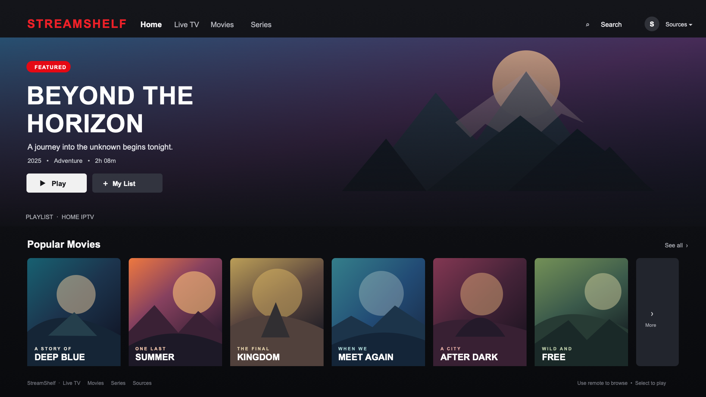

# StreamShelf for Fire TV

## App UI preview

A native Android TV IPTV player for Fire TV. It accepts multiple M3U playlist URLs, keeps their names and URLs encrypted with Android Keystore on the device, parses standard `#EXTINF` items and common `group-title` / `tvg-logo` attributes, and provides Live, Movies, and Series shelves with ExoPlayer playback. Artwork loads off the UI thread into memory and disk caches, and shelves add more items in small batches so large playlists appear faster. Version 1.4.1 fixes a startup crash in the featured home-screen panel.

## Compatibility

- Fire OS 7 / Android 9 and newer (minSdk 24; tested target device family: Fire TV)
- Android Studio is not needed on your Mac to build this project: GitHub Actions can build it on an Ubuntu runner.
- First version focuses on groups and playback. XMLTV EPG, richer series season/episode grouping, poster artwork loading, favorites, and resume support are not included yet.

Classification uses group and item text: groups or titles mentioning movie/VOD/film go to Movies; series/season/episode/shows go to Series; other entries go to Live. M3U metadata is inconsistent, so some entries may need better classification rules for a particular provider. `tvg-logo` is parsed but the first UI version uses text tiles.

## Fire TV remote

The home screen uses a full-screen dashboard with a left navigation rail, featured title, and horizontal Movies, Series, and Live TV shelves. Use the D-pad to navigate, **Select** to open a title, **Menu** to add or remove a focused title from My List, **Search** to search the active playlist, and **Back** to leave playback. The player handles remote play/pause keys, shows buffering and retry feedback, and pauses when StreamShelf goes into the background. The app includes an adaptive launcher icon and a dedicated Leanback banner for Fire TV. Entries without a valid `tvg-logo` keep a branded placeholder.

## Build APK remotely with GitHub Actions

1. The app starts with the supplied MyList M3U URL on a fresh install. The playlist contents are fetched at runtime and are not copied into this repository. Existing installs with a saved playlist keep their current source.
2. Open **Actions → Build StreamShelf APK → Run workflow** (or push to `main`).
3. Download the `streamshelf-debug-apk` artifact from the completed workflow run. It contains `app-debug.apk`.
4. Sideload the APK using your preferred Fire TV method. The app is not signed for Play Store distribution; the debug APK is appropriate for personal sideloading.

The workflow installs Java 17, Gradle 8.9, Android SDK platform 35, and builds the APK on GitHub's runner. No Android SDK, Gradle, Java, or Android Studio installation is needed locally.

## Add playlists

On a fresh install, StreamShelf loads the supplied MyList M3U URL by default. Open Sources to add more playlist URLs; use the source label above the shelves to switch playlists. Playlist URLs may contain account credentials; they are AES-GCM encrypted with a key held by Android Keystore. User-added URLs are not uploaded by the app. The built-in default is only a URL; playlist contents are fetched at runtime.

## Project structure

- `app/src/main/java/tv/sachin/streamshelf/MainActivity.java`: UI, playlist parser, encrypted source storage, playback
- `app/src/main/AndroidManifest.xml`: Fire TV launcher entry and internet permission
- `app/src/main/res/`: adaptive icon, Leanback banner, and artwork placeholders
- `.github/workflows/build.yml`: remote APK build

## Notes

This player only displays and plays streams provided by the user. It does not include channels or content. Make sure you have permission to access each playlist and stream.
